# Architecture: one data flow through six layers

How a fault in Banksia Mobile's network becomes a pinpointed element on the NOC operator's screen and an answer in
Genie, with the actual object names. Every arrow is code in this repo and was exercised end to end on the workspace
(`evidence/step5/03_trace_site_power_outage.md` follows one real fault through every hop).

```mermaid
flowchart LR
  subgraph L1["1 Lakeflow (ingest + transform)"]
    GEN["generator jobs<br/>notebooks/01, 02"] --> VOL[("UC Volume<br/>netmon_raw.landing/stream/*.json")]
    VOL -- Auto Loader --> BR["netmon_bronze.bronze_kpis / _alarms / _sessions / _topology_*"]
    BR -- "expectations, dedupe,<br/>topology join" --> SI["netmon_silver.silver_kpis / silver_alarms /<br/>silver_topology_nodes (+ silver_quarantine)"]
    SI --> GO["netmon_gold.gold_impact_detections<br/>gold_cell_health_1m/5m · gold_element_impact_5m"]
  end
  subgraph L2["2 Unity Catalog (governance)"]
    GOV["netmon_gov: region_filter · mask_imsi · mask_msisdn"]
    NOCV["netmon_noc views (region-filtered):<br/>open_incidents · element_status · incident_ai_summary ·<br/>customer_sms_drafts · incident_detection_times · gold_* · silver_*"]
    EVAL["netmon_eval (ground truth, scoring only)"]
  end
  subgraph L3["3 ML (RCA ranker)"]
    SC["job banksia-rca-score-live<br/>rca_ranker@champion (v5)"] --> LS["netmon_rca.rca_live_scores"]
    SC --> OI["netmon_rca.open_incidents (top-3)<br/>netmon_rca.element_status"]
    EP["serving endpoint banksia-rca-ranker"]
  end
  subgraph L4["4 Gen AI (NOC assistant)"]
    AS["job banksia-genai-assistant<br/>(table-update trigger)"] -- "AI Gateway" --> LLM["databricks-gpt-5-4-mini"]
    AS --> AI["netmon_genai.incident_ai_latest<br/>incident_ai_summaries · customer_notice_drafts"]
  end
  subgraph L5["5 Lakebase (operational store)"]
    LB[("banksia-netmon-lakebase / netmon_serving:<br/>netmon_rca.lb_open_incidents · lb_element_status<br/>netmon_genai.lb_incident_ai_latest<br/>netmon_app.sms_draft_reviews (app writes)")]
  end
  subgraph L6["6 Apps + Genie (NOC operator)"]
    APP["Databricks App banksia-noc-topology<br/>FastAPI + JS: topology, map, incident panel,<br/>SMS review, Ask Genie"]
    GEN_SPACE["Genie space<br/>'Banksia NOC: incidents, network health…'"]
  end
  GO --> SC
  SI --> SC
  OI --> AS
  LS --> AS
  GO --> AS
  OI -- "synced table (TRIGGERED)" --> LB
  AI -- "synced table (TRIGGERED)" --> LB
  GOV -.-> SI & GO & NOCV
  GO & SI & OI & AI --> NOCV
  LB -- "psycopg + OAuth<br/>(app service principal)" --> APP
  APP -- "approve / reject INSERT" --> LB
  NOCV -- "SQL warehouse, on-behalf-of user" --> APP
  APP -- "Genie Conversation API,<br/>on-behalf-of user" --> GEN_SPACE
  NOCV --> GEN_SPACE
  EVAL -- "eval_ttd_summary (labelled scorecard)" --> GEN_SPACE
  LS -.->|"same features, on-demand re-score"| EP
```



Text version of the same flow (left to right is time):

```
generator ─► /Volumes/…/netmon_raw/landing/stream/{kpis,alarms}/date=…/batch-*.json
          ─► [Lakeflow, Auto Loader] netmon_bronze.bronze_*  (_source_file = the file path)
          ─► [Lakeflow, expectations + quarantine] netmon_silver.silver_*  (typed, UTC + local time, topology ancestors)
          ─► [Lakeflow, stateless detection] netmon_gold.gold_impact_detections (+ 1/5-min health, topology rollup)
          ─► [job banksia-rca-score-live, rca_ranker@champion] netmon_rca.rca_live_scores ─► open_incidents (top-3)
                                                                                         ─► element_status
          ─► [job banksia-genai-assistant, AI Gateway, gpt-5-4-mini] netmon_genai.incident_ai_latest (+ SMS drafts)
          ─► [synced tables] Lakebase netmon_serving: lb_open_incidents · lb_element_status · lb_incident_ai_latest
          ─► [app banksia-noc-topology, psycopg as the app SP] topology + pinpoint + incident panel + SMS draft
          ─► operator approves / rejects ─► Lakebase netmon_app.sms_draft_reviews (never sent)
  in parallel: netmon_noc views (UC row filter for the asking user) ─► Genie space ◄─ app "Ask Genie" (as the user)
```

## Layers, why each one, and how it connects

| # | layer | objects | why this layer | connects to |
|---|---|---|---|---|
| 1 | **Lakeflow** (Spark Declarative Pipelines, serverless) | `pipelines/netmon/`, pipeline `banksia-netmon`, `netmon_bronze` → `netmon_silver` → `netmon_gold` | Streaming with expectations, quarantine and watermarks in one declarative pipeline: the 5-minute detection SLA needs continuous, stateless detection, and DQ must be visible per rule | its gold tables are the ranker's features (3), the assistant's context (4) and the Genie views (2/6) |
| 2 | **Unity Catalog** | `netmon_gov` functions, `netmon_noc` views (`governance/sql/02`, `05`), masks on `silver_sessions`, grants, tags, lineage | One place for who-sees-what: regional row filters and IMSI / MSISDN masks evaluated for the *querying user*, which is what makes Genie and the app's on-behalf-of reads safe | every layer's tables live here; the app's and Genie's queries go through its views; lineage links the tables |
| 3 | **ML** (MLflow, UC model registry, Model Serving) | `netmon_rca.rca_ranker@champion` (v5), job `banksia-rca-score-live`, endpoint `banksia-rca-ranker` | A trained ranker beats the topology heuristic at naming the failing element (94.7 % vs 78.3 % top-1 on the fresh holdout) and gives calibrated scores for the top-3 | reads gold (1); writes `open_incidents` / `element_status` (→ 5) and `rca_live_scores` (→ 4) |
| 4 | **Gen AI** (Foundation Model API through AI Gateway, MLflow tracing) | job `banksia-genai-assistant`, `netmon_genai.*` | Turns the ranker's numbers into a NOC-readable root cause, runbook steps and a customer SMS draft, grounded only in the build's tables and guard-checked | triggered by `open_incidents` (3); writes `incident_ai_latest` (→ 5, → 2 view) |
| 5 | **Lakebase** (Provisioned Postgres, synced tables) | instance `banksia-netmon-lakebase`, database `netmon_serving` | Millisecond reads for the operator's screen (server-side p50 10–29 ms per call in `04_app_deployment.md`) and a transactional write path for the SMS decision, without keeping a SQL warehouse hot | fed by synced tables from 3 and 4; read and written by the app (6) |
| 6 | **Databricks App + Genie** | app `banksia-noc-topology` (`app/`), Genie space `noc_genie` (`resources/genie.yml`) | The NOC's single pane: where the failing element is, how bad, what to do, approve the customer message, ask follow-up questions in English | app reads 5 (as its SP) and 2 (as the user), writes 5, calls Genie as the user; Genie queries 2 |

## Identity along the path

| hop | runs as |
|---|---|
| pipeline, scoring job, assistant job, governance job | the job owner (`louis.chen@…`, a `noc_national` member without `pii_privileged`) |
| app → Lakebase | the app's service principal (OAuth database credential; SELECT on the three synced tables, owner of `netmon_app`) |
| app → SQL warehouse (region scope, inventory, detection timing, KPIs) | the signed-in user (on-behalf-of token, scope `sql`) |
| app → Genie, Genie → SQL | the signed-in user (scope `dashboards.genie`) |

Ground truth (`netmon_eval`) feeds no operational table, the ranker's features, the assistant's context, the app, or
the Genie space's operational views. The one exception is the Genie space's labelled scorecard table
`netmon_eval.eval_ttd_summary`, which the app also shows as "evaluation" and which only the national role can read.
